# Bitácora – Parte 1: Kernel y arranque mínimo

**Estudiante:** Mateo Albornoz Gil (Mag) · **Equipo:** 03  
**Asignatura:** Sistemas Operativos – Ingeniería de Software  
**Kernel usado:** Linux **6.18.60** (rama longterm 6.18) · **Fecha:** 3 de noviembre de 2026

> **Nota sobre el número de equipo:** este proyecto lo estoy desarrollando de forma individual y no asistí a la clase en la que se asignaron los números de equipo, así que no tengo uno asignado. Usé el **03**, que es el número de ejemplo de la guía, en el sufijo del kernel (`-equipo03`), en `init.c` y en los parámetros de prueba. Si me indican otro número, actualizo el sufijo y vuelvo a generar las evidencias.

---

## E1 – Trabajo autónomo

| Dato | Valor |
|---|---|
| Sistema de la VM | Ubuntu 26.04.1 LTS (VirtualBox) |
| CPU de la VM (`nproc`) | 6 |
| RAM de la VM (`free -h`) | 7,2 GiB (+ 3,8 GiB de swap) |
| Disco libre | 44 GB |
| Tiempo de compilación defconfig (`real`) | **11 min 24,198 s** (user 46m38s, sys 12m33s) |
| Tamaño del bzImage | 14 MB |
| Salida de `file` | `Linux kernel x86 boot executable, bzImage, version 6.18.60-equipo03 (root@mag-VirtualBox) #1 SMP PREEMPT_DYNAMIC Tue Nov 3 15:30:05 -05 2026 ...` |

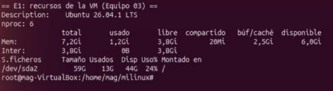

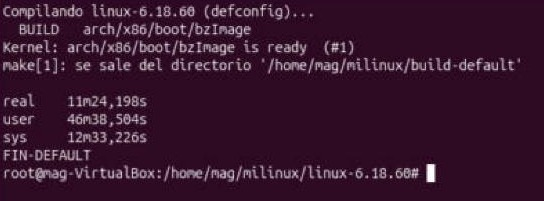

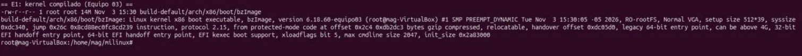

---

## E2 – Actividad 1: exploración de la configuración

**P1.** En *General setup → Local version - append to kernel release* aparece `(-equipo03)`. Es el sufijo que pusimos con `scripts/config --set-str LOCALVERSION` en el Paso 4. Ya lo habíamos visto antes en la salida de `file` del bzImage, donde la versión sale como `6.18.60-equipo03`. Es lo que identifica al kernel como compilado por nuestro equipo.

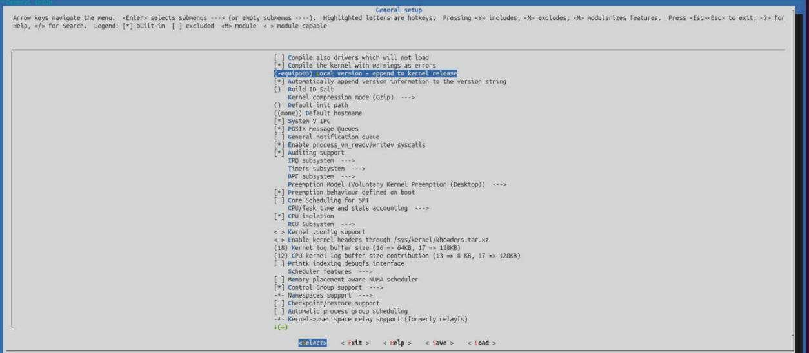

**P2.** En *Processor type and features → Maximum number of CPUs* el valor es **64** (`CONFIG_NR_CPUS=64`). El kernel reserva estructuras internas para ese máximo de procesadores. Si la máquina tuviera más de 64 CPU, este kernel solo usaría 64.

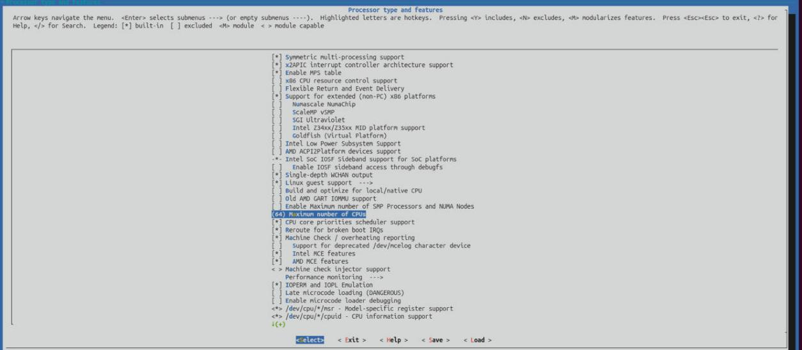

**P3.** *The Extended 4 (ext4) filesystem* está en `<*>`, o sea compilado dentro del kernel (`CONFIG_EXT4_FS=y`). Si estuviera como módulo `<M>` y la raíz fuera ext4, tendríamos un problema circular: el módulo de ext4 es un archivo guardado en el disco, pero para leer el disco hace falta ext4. El kernel no podría montar `/` y entraría en panic. La única salida sería un initramfs que traiga el módulo y lo cargue antes de montar la raíz, que es justo lo que hacen las distribuciones.

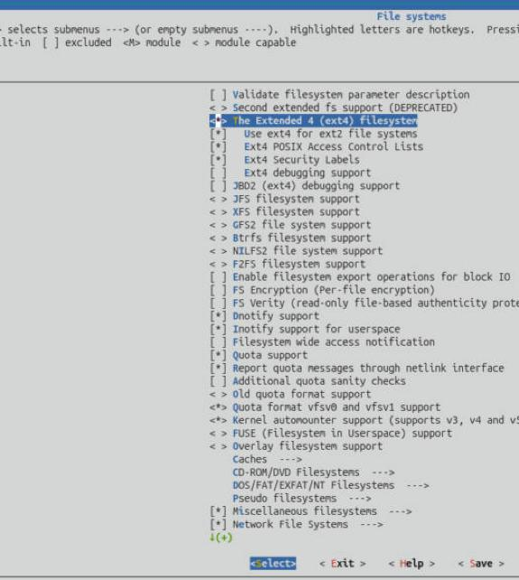

**P4.**

| Opción | Ubicación en el menú | Valor | Para qué la necesita el proyecto |
|---|---|---|---|
| `BLK_DEV_INITRD` | General setup → Initial RAM filesystem and RAM disk (initramfs/initrd) support | `y` | Permite que el kernel cargue el initramfs donde va nuestro `/init` (Actividad 4) |
| `SERIAL_8250_CONSOLE` | Device Drivers → Character devices → Enable TTY → Serial drivers → 8250/16550 and compatible serial support → Console on 8250/16550 and compatible serial port | `y` | Permite usar `ttyS0` como consola. Con `-nographic`, QEMU conecta ese puerto serie a la terminal; sin esta opción no veríamos ningún mensaje |

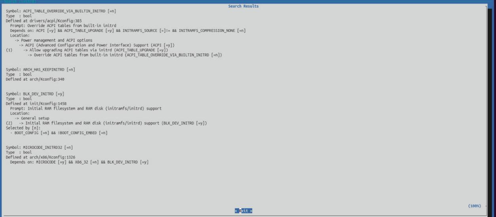

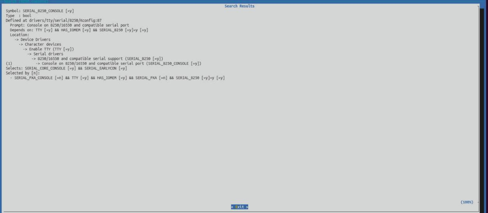

**P5.** En `build-default/.config` hay **1635 opciones `=y`** (dentro del kernel) y **12 `=m`** (módulos). Casi todo queda dentro del kernel porque defconfig está pensado para que el kernel arranque por sí solo en un PC típico o en una VM, sin depender de cargar módulos desde el disco.

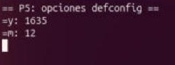

Las configuraciones quedaron guardadas en `bitacora/config-default` y `bitacora/config-tiny`.

**Verificación del tinyconfig (Actividad 2):** el `grep` mostró las 5 líneas obligatorias en `=y`: `CONFIG_64BIT`, `CONFIG_PRINTK`, `CONFIG_SERIAL_8250_CONSOLE`, `CONFIG_BLK_DEV_INITRD` y `CONFIG_BINFMT_ELF`. El tiny compiló en **2 min 12,359 s**.

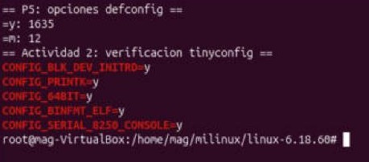

---

## E3 – Actividad 3: arranque sin espacio de usuario

Log: `logs/arranque-sin-init.log` (365 líneas).

**P6.**

```
[    0.000000] Linux version 6.18.60-equipo03 (root@mag-VirtualBox) (gcc (Ubuntu 15.2.0-16ubuntu1) 15.2.0, GNU ld (GNU Binutils for Ubuntu) 2.46) #1 SMP PREEMPT_DYNAMIC Tue Nov  3 15:30:05 -05 2026
[    0.000000] Command line: console=ttyS0
[    0.760754] Memory: 213060K/261624K available (19088K kernel code, 2907K rwdata, 7596K rodata, 2820K init, 904K bss, 46352K reserved, 0K cma-reserved)
```

- **Linux version:** muestra qué kernel arrancó (6.18.60 con nuestro sufijo `-equipo03`), quién lo compiló y en qué máquina, con qué compilador (gcc 15.2.0) y cuándo. Sirve para confirmar que es nuestro kernel y no otro.
- **Command line:** los parámetros que el cargador le pasó al kernel. Aquí el cargador es QEMU con `-append`, y solo se pasó `console=ttyS0`.
- **Memory:** de los 256 MB (261624K) que le dimos a QEMU, quedan **213060K disponibles**. El resto lo ocupa el propio kernel: 19088K de código, datos de solo lectura y de escritura, y 46352K reservados.

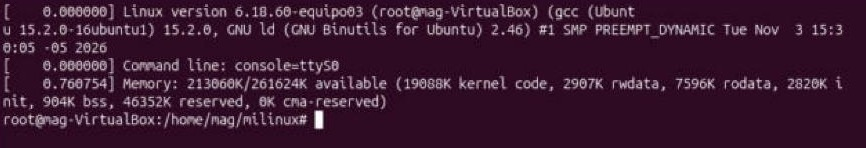

**P7.** El kernel sí arrancó: detectó CPU, memoria y dispositivos. Se detiene porque, después de inicializar todo, tiene que montar un sistema de archivos raíz (`/`) para buscar el primer programa de usuario. No le dimos ni initramfs ni disco y `root=` estaba vacío, así que sale `VFS: Cannot open root device "" or unknown-block(0,0): error -6` y luego `Kernel panic - not syncing: VFS: Unable to mount root fs on unknown-block(0,0)`. Sin raíz no hay dónde buscar init y el kernel no tiene nada más que hacer, por eso entra en panic.

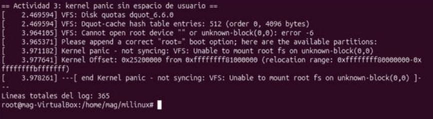

**P8.** No. El kernel por sí solo administra el hardware y los recursos, pero no hay ningún programa que los use: ni shell, ni comandos, nada con lo que el usuario pueda interactuar. El log lo muestra claro: reconoció todo el hardware y aun así terminó en panic porque no tenía un programa de espacio de usuario que ejecutar. Un sistema operativo usable necesita el kernel más el espacio de usuario.

---

## E4 – Actividad 4: el primer proceso

Archivos: `src/init.c`, `logs/arranque-init.log`, `logs/arranque-parametros.log`.

`file src/init` → `ELF 64-bit LSB executable, x86-64, version 1 (GNU/Linux), statically linked` (803 KB). El initramfs `initramfs.cpio.gz` pesa 346 KB y contiene `/init` y `/dev/console`.

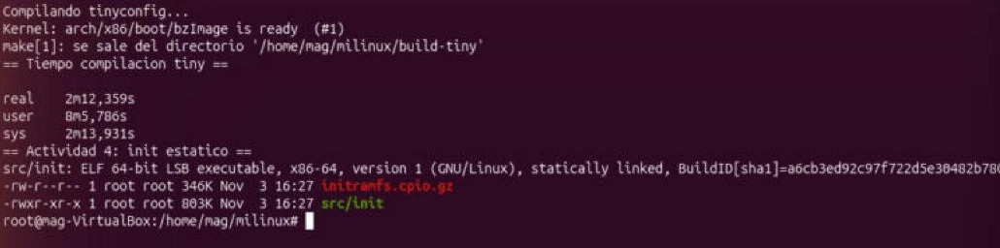

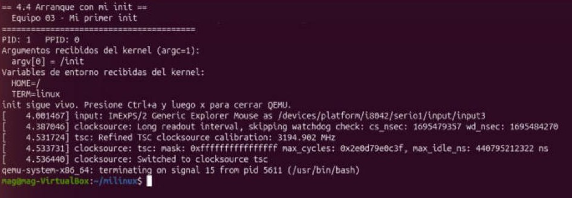

**P9.** El programa sale con **PID 1 y PPID 0**. El PPID es 0 porque a init no lo crea un proceso de usuario con `fork()`: lo lanza el propio kernel al terminar de arrancar, desde su hilo inicial (el proceso 0, *swapper/idle*), que no es un proceso de usuario normal. Por eso init es la raíz del árbol de procesos y todos los demás van a ser sus descendientes.

**P10.** Se compiló con `-static` porque el initramfs solo tiene `/init` y `/dev/console`. No hay bibliotecas compartidas (`libc.so.6`) ni el cargador dinámico (`/lib64/ld-linux-x86-64.so.2`). Con `-static`, el código de la libc queda metido dentro del ejecutable, y por eso pesa 803 KB en vez de unos 16 KB.

**Predicción sin `-static`:** el kernel intentaría cargar el intérprete dinámico que pide el ELF, no lo encontraría y fallaría con `Failed to execute /init (error -2)` (No such file or directory). Después saldría `Kernel panic - not syncing: No working init found`.

**P11.** Arranque con `-append "console=ttyS0 quiet hola EQUIPO=03"`:

| Parámetro | ¿Qué hizo con él el kernel? | Evidencia |
|---|---|---|
| `console=ttyS0` | Lo usó el kernel y no llegó a init | no aparece en `argv` ni en `envp` |
| `quiet` | Lo usó el kernel y no llegó a init | el log bajó de 351 a 21 líneas |
| `hola` | Lo pasó a init como **argumento** | `argv[1] = hola` (argc=2) |
| `EQUIPO=03` | Lo pasó a init como **variable de entorno** | `EQUIPO=03` en `envp` |

En el arranque **sin** `quiet` (con `hola EQUIPO=03`) el kernel lo avisa:
`Unknown kernel command line parameters "hola EQUIPO=03", will be passed to user space.`
Con `quiet` ese aviso no se imprime, porque `quiet` baja el nivel de log de la consola.

**La regla:** el kernel se queda con los parámetros que reconoce. Los que no reconoce se los pasa a PID 1: si tienen `=` van como variable de entorno, y si no tienen `=` van como argumento. Además, el kernel siempre le pasa `argv[0] = /init` y las variables `HOME=/` y `TERM=linux` (fuente: *The kernel's command-line parameters*, docs.kernel.org).

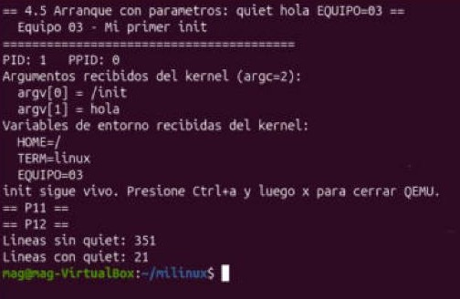

**P12.** Sin `quiet` el log tuvo **351 líneas** y con `quiet` solo **21**. A `quiet` lo consumió el **kernel**: baja el `loglevel` de la consola para que solo se impriman los mensajes importantes. Por eso no aparece ni en `argv` ni en `envp` de nuestro init. Lo que sí se sigue viendo es lo que imprime init, porque eso es espacio de usuario.

---

## E5 – Actividad 5: matar a PID 1 y comparar

Logs: `logs/arranque-salir.log`, `logs/medir-default-{1,2,3}.log`, `logs/medir-tiny-{1,2,3}.log`.

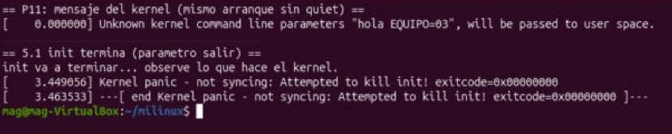

### Tabla comparativa

| Medida | defconfig | tinyconfig |
|---|---|---|
| Tamaño de bzImage | 14 MB | 977 KB |
| Opciones dentro del kernel (`=y`) | 1635 | 527 |
| Tiempo de compilación (`real`) | 11 min 24 s | 2 min 12 s |
| Tiempo de arranque hasta PID 1 (mediana de 3) | **6,01 s** | **2,78 s** |
| Memoria disponible (línea `Memory:`) | 212712K de 261624K | 246936K de 261624K |
| Código del kernel (misma línea) | 19088K | 3680K |

Corridas de arranque: defconfig = 6,68 · 6,01 · 5,84 s; tinyconfig = 2,60 · 2,78 · 3,09 s.
Cada tiempo se midió desde que se lanza QEMU hasta que init ejecuta `reboot()` con el parámetro `medir` y QEMU se cierra gracias a `-no-reboot`.

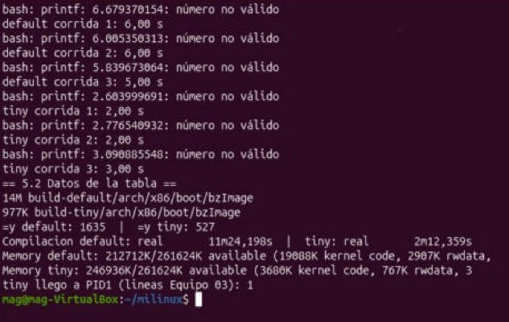

**P13.**

- **Actividad 3:** `Kernel panic - not syncing: VFS: Unable to mount root fs on unknown-block(0,0)`. Falló **antes** de que existiera el espacio de usuario: el kernel no encontró sistema de archivos raíz y por eso ni siquiera pudo buscar `/init`.
- **5.1:** `Kernel panic - not syncing: Attempted to kill init! exitcode=0x00000000`. Aquí todo funcionó: había raíz (el initramfs) y `/init` se ejecutó e imprimió su mensaje, pero después terminó con `return 0` (por eso el exitcode es 0, es decir, sin error).
- **¿Por qué el kernel no puede seguir sin PID 1?** Porque init es el ancestro de todos los procesos de usuario. También es el que adopta a los procesos huérfanos y recoge su estado de salida para que no queden como zombis. Si PID 1 muere, no queda nadie en espacio de usuario que mantenga el sistema ni que pueda crear procesos nuevos, y el kernel no tiene cómo reemplazarlo. Por eso hace panic. Nuestro init evita terminar con un `for(;;) pause();`.

**P14.** Las diferencias de la tabla salen de lo que trae cada configuración:

- **Tamaño (14 MB contra 977 KB):** defconfig incluye drivers de discos, red, USB, gráficos y varios sistemas de archivos. tinyconfig parte de todo desactivado y solo tiene lo que activamos a mano, por eso su bzImage es unas 14 veces más pequeño.
- **Opciones `=y` (1635 contra 527):** el tiny tiene menos de un tercio de las opciones. Es casi un esqueleto.
- **Compilación (11:24 contra 2:12):** al haber mucho menos código que compilar, el tiny tardó como la quinta parte.
- **Arranque (6,01 s contra 2,78 s):** el tiny arranca en menos de la mitad del tiempo porque no tiene que inicializar ni sondear todos esos drivers y subsistemas antes de lanzar `/init`.
- **Memoria (212712K contra 246936K disponibles):** el código del kernel tiny ocupa 3680K frente a 19088K, así que deja unos 34 MB más de RAM libre para los programas.

**P15.** Tres capacidades que tinyconfig no tiene y que vamos a necesitar en las siguientes partes:

1. **Soporte de disco:** la capa de bloques completa y los drivers de controladoras (ATA/SATA/AHCI, virtio-blk, PCI) para leer un disco real en lugar del initramfs.
2. **Sistema de archivos ext4** (`CONFIG_EXT4_FS`), para montar la raíz desde ese disco.
3. **Red:** la pila TCP/IP (`CONFIG_NET`, `CONFIG_INET`) y un driver de tarjeta de red (e1000 o virtio-net) para conectar el sistema.

Además le faltan otras cosas, como el soporte de módulos cargables, USB y sistemas de archivos como tmpfs o vfat.

---

## Problemas encontrados

| Mensaje / síntoma | Causa | Cómo lo resolví |
|---|---|---|
| El teclado dejó de responder dentro de la VM | Se usó el teclado en pantalla de VirtualBox y quedaron "pegadas" teclas modificadoras (Ctrl/Shift) | Se reinició la VM. Después, cada vez que se usaba un atajo como `Ctrl+Shift+V`, se soltaban Ctrl y Shift antes de seguir |
| `sudo: Authentication failed` | La contraseña se escribió con Ctrl/Shift pegados (sudo no muestra lo que se escribe) | Se repitió la contraseña con el teclado normal |
| La pantalla de Ubuntu se bloqueó durante la compilación | Bloqueo automático por inactividad de GNOME | Se desactivó con `gsettings set org.gnome.desktop.session idle-delay 0` y `org.gnome.desktop.screensaver lock-enabled false` |
| La terminal y luego toda la VM se congelaron al correr QEMU con `timeout` | QEMU con `-nographic` deja la terminal en modo crudo, y con `timeout` quedó en segundo plano peleando por la terminal. Además estaba activa la aceleración 3D de VirtualBox | Se reinició la VM, se desactivó la aceleración 3D y se corrió QEMU con `< /dev/null > log`, en segundo plano, para que no tocara la terminal |
| Avisos `vmwgfx ... unsupported hypervisor` al arrancar Ubuntu | El driver gráfico de Ubuntu 26.04 detecta VirtualBox y avisa | Solo es una advertencia, no afecta |

## Fuentes

- Linux Kernel Archives – versiones longterm: https://www.kernel.org/category/releases.html
- Ramfs, rootfs and initramfs: https://docs.kernel.org/filesystems/ramfs-rootfs-initramfs.html
- The kernel's command-line parameters: https://docs.kernel.org/admin-guide/kernel-parameters.html
- The Linux/x86 Boot Protocol: https://docs.kernel.org/arch/x86/boot.html
- QEMU – Direct Linux Boot: https://www.qemu.org/docs/master/system/linuxboot.html
